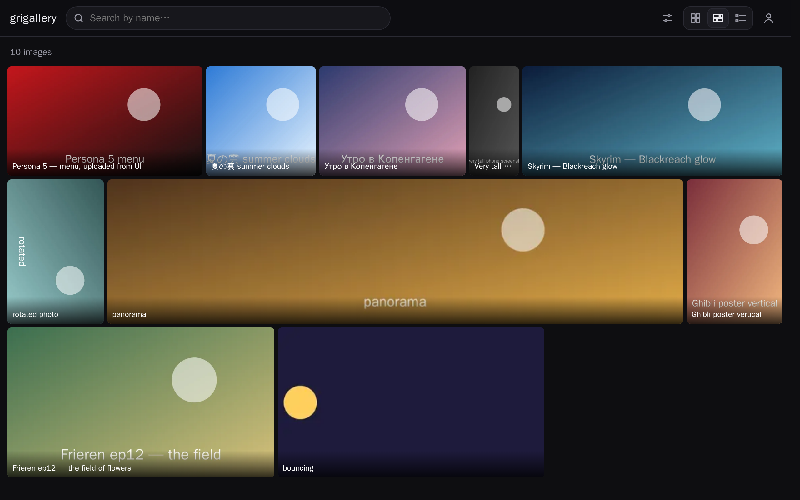
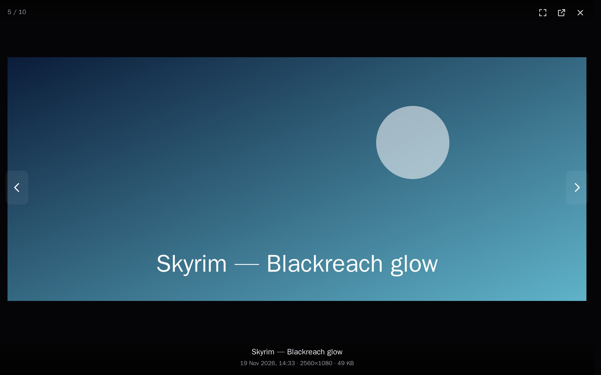
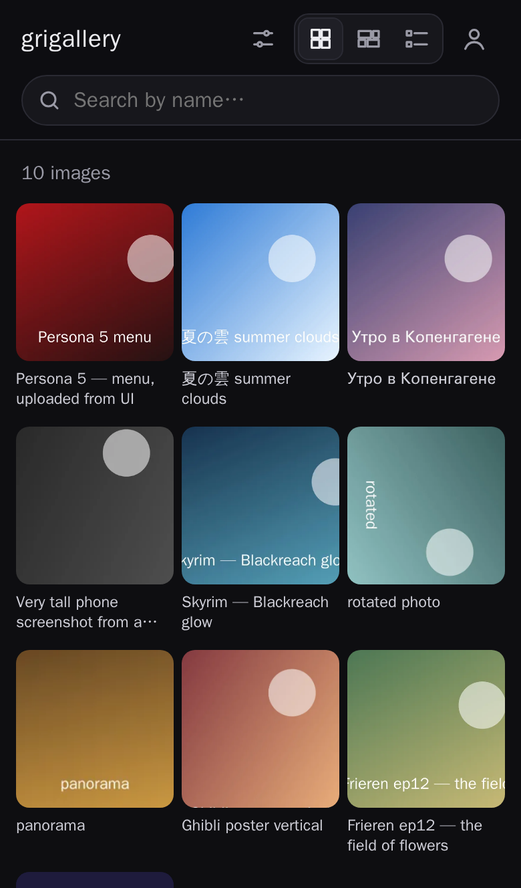

# grigallery

A small personal gallery for screenshots and pictures worth keeping. Anyone can browse;
uploading, renaming and deleting need a login. The name of each picture carries its
context, so names are always shown and can be edited.



| Viewer | Phone |
| --- | --- |
|  |  |

## Features

- **Views:** grid, justified rows and list. The choice is remembered and rendered by the server.
- **Viewer:** full screen, arrows, keyboard (← → Esc F), swipes on phones, tap to hide the controls.
  Every picture has its own link (`/?img=…`), and Back closes the viewer.
- **Sort and filter:** by upload date or name, search by name, filter by upload date.
- **Upload:** file picker, drag and drop anywhere on the page, or paste a screenshot (Ctrl+V).
  Names default to the file name and can be edited before and after upload.
- **Formats:** JPEG, PNG, WebP, GIF (animated previews too) and AVIF. Duplicates are recognised by content.
- **Phones:** three-column grid, compact list, swipe navigation, safe-area aware.

Stack: SvelteKit 3 (Svelte 5, TypeScript) on Node 24, SQLite via the built-in `node:sqlite`,
`sharp` for previews.

## Data

Everything lives in one folder (`/data` in the container):

```
data/
  originals/   files exactly as uploaded, named by random id
  thumbs/      WebP previews (animated for GIFs)
  gallery.db   names, sizes and dates
```

Copying this folder is a complete backup.

## Running with Docker

```bash
cp .env.example .env          # set ORIGIN to the site's address
npm run hash-password         # or: node scripts/hash-password.mjs
                              # paste the output into ADMIN_PASSWORD_HASH
node -e "console.log(require('crypto').randomBytes(32).toString('base64url'))"   # SECRET_KEY
mkdir -p data
docker compose up -d --build
```

The container listens on port 3000. Caddy:

```
gallery.example.com {
	request_body {
		max_size 60MB
	}
	reverse_proxy grigallery:3000
}
```

`ORIGIN` in `.env` must match the address people open, or uploads and login are rejected
by SvelteKit's CSRF protection.

## Development

```bash
npm install
cp .env.example .env    # ORIGIN=http://localhost:5173, plus a password hash
npm run dev
npm run check           # types
```
