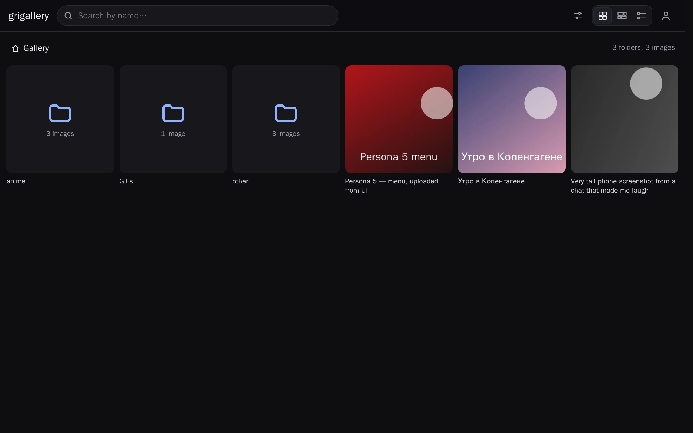
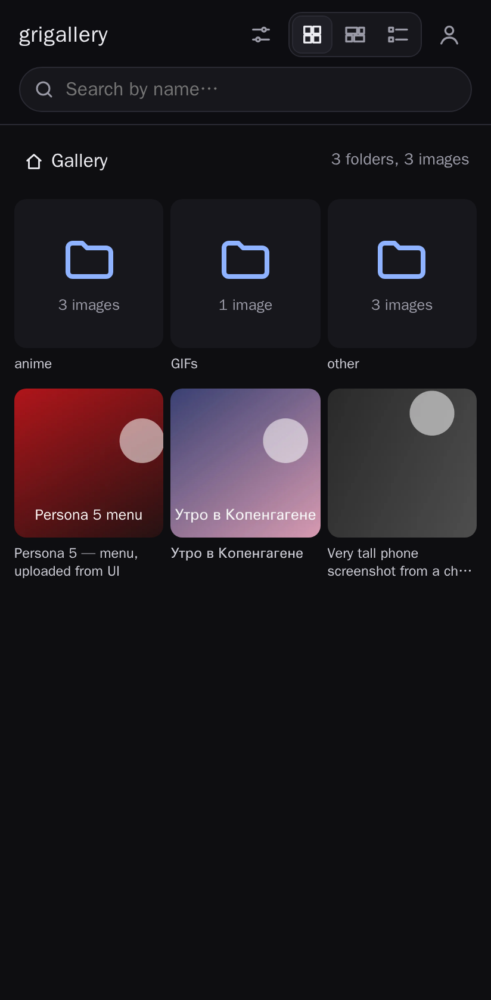

# grigallery

A small personal gallery for screenshots and pictures worth keeping. Anyone can browse;
uploading, renaming and deleting need a login. The name of each picture carries its
context, so names are always shown and can be edited.



| Viewer | Phone |
| --- | --- |
|  |  |

## Features

- **Folders:** the gallery works like a file system. The root holds folders and loose pictures,
  folders can be nested, and each has its own address (`/anime/frieren`). Folders can be created,
  renamed, moved and deleted; deleting one moves its contents up a level.
- **Sorting pictures into folders:** move one from the viewer, or select several and move or delete them together.
- **Views:** grid, justified rows and list. The choice is remembered and rendered by the server.
- **Viewer:** full screen, arrows, keyboard (← → Esc F), swipes on phones, tap to hide the controls.
  Every picture has its own link (`/?img=…`), and Back closes the viewer.
- **Sort and filter:** by upload date or name, search by name, filter by upload date.
  Searching looks through the open folder and everything inside it.
- **Upload:** file picker, drag and drop anywhere on the page, or paste a screenshot (Ctrl+V),
  into the open folder or any other. Names default to the file name and can be edited before and after upload.
- **Formats:** JPEG, PNG, WebP, GIF (animated previews too) and AVIF. Duplicates are recognised by content.
- **Phones:** three-column grid, compact list, swipe navigation, safe-area aware.

Stack: SvelteKit 3 (Svelte 5, TypeScript) on Node 24, SQLite via the built-in `node:sqlite`,
`sharp` for previews.

## Data

Everything lives in one folder (`/data` in the container):

```
data/
  originals/   files exactly as uploaded, named by random id
  thumbs/      WebP previews (animated for GIFs)
  gallery.db   names, sizes, dates and folders
```

Copying this folder is a complete backup.
